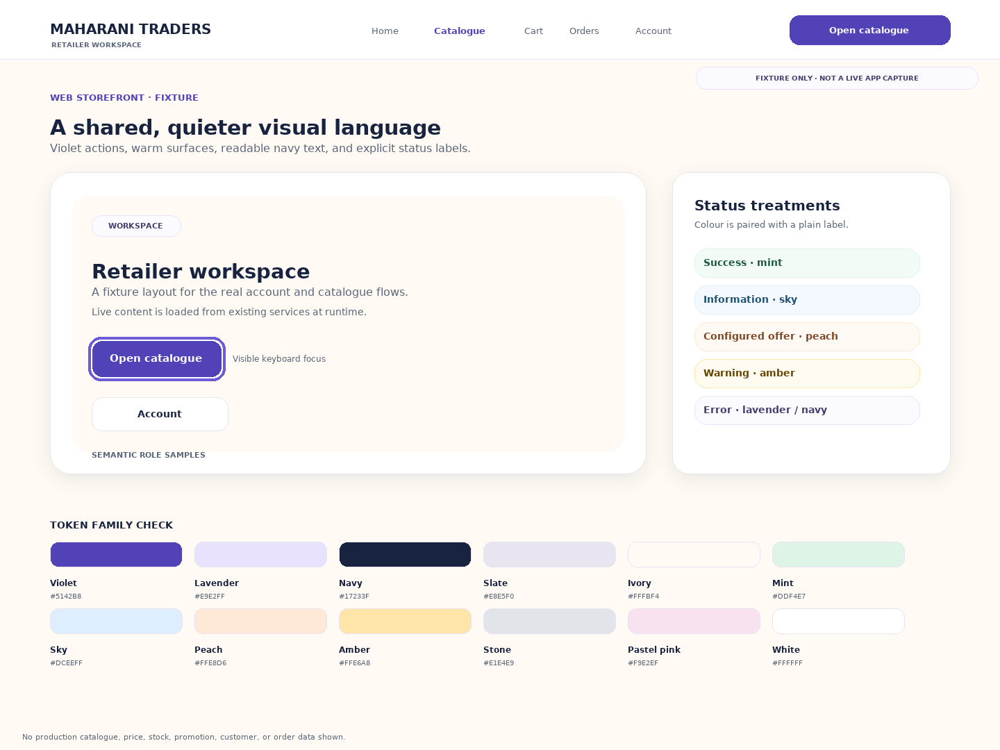
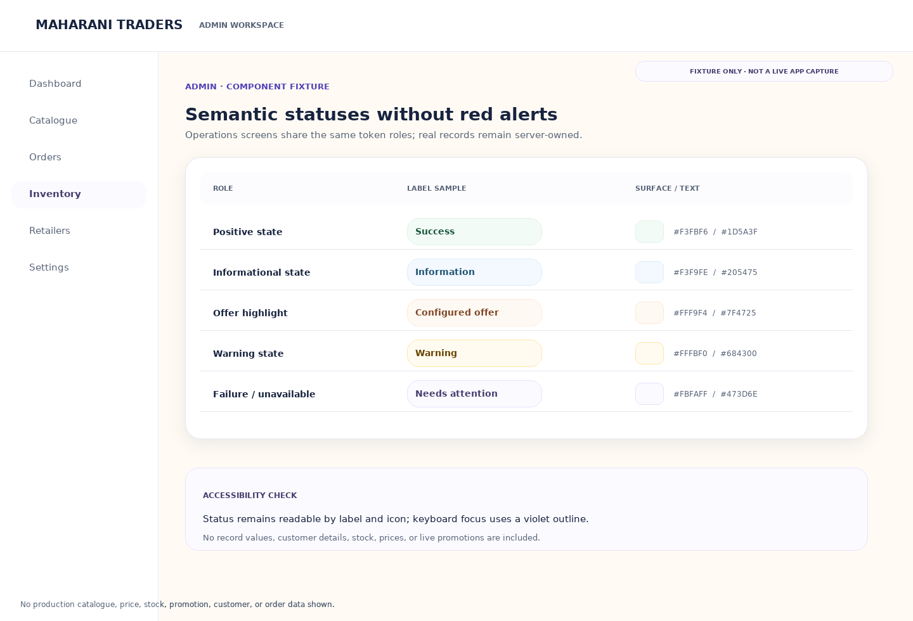
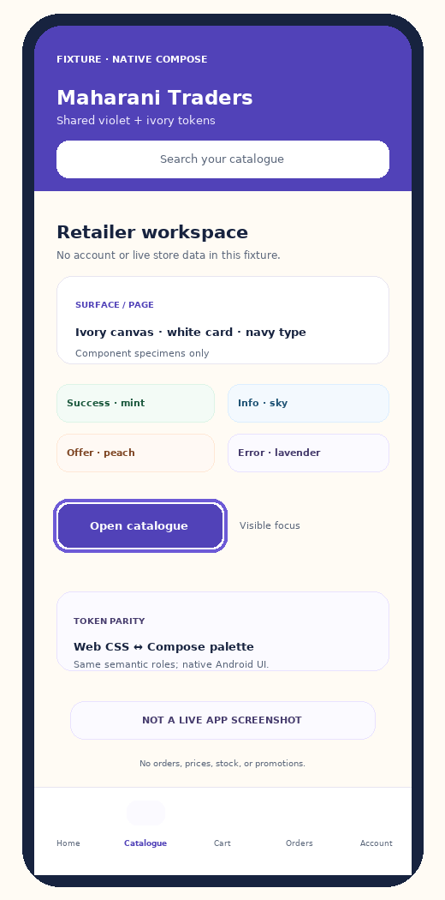

# Premium pastel redesign — visual review and verification

**Review date:** 16 October 2026 
**Branch:** `arena/a6181eba-maharani-mart` 
**Review type:** fixture-only; not a production acceptance review

## Visual review: fixture images, not app screenshots

A browser executable, Android emulator, and authenticated production session were not available. The images below are **hand-composed static fixtures from the canonical token registry**, not screenshots of the running Next.js site or Compose app. They contain no production catalogue, prices, promotions, stock, customer, or order data. Each image is also labelled as a fixture.

### Retailer web colour and focus fixture

### Admin semantic status fixture

### Android Compose token-parity fixture

**Visual assessment:** the fixtures show violet primary/focus treatment, warm ivory page surfaces, white cards, navy/slate text, mint positive status, sky information, peach offer styling, amber warnings, and neutral lavender errors. Status labels remain explicit instead of relying on colour alone. The actual UI source and the launcher/splash assets pass the automated prohibited-colour audit. Runtime rendering, device-specific contrast, and real 320–1440px viewport screenshots remain unverified here.

## Design-system contract

- `design/tokens.json` is canonical: **117 palette values**, **12 families**, **39 semantic aliases**, and **18 documented contrast pairs**.
- `app/design-tokens.generated.css` and Android Compose `MaharaniPalette` are generated from the same registry. `node scripts/generate-design-tokens.mjs` reported 117 palette tokens and 39 semantic aliases; a repeat run left both generated outputs byte-for-byte unchanged.
- The contract tests compare every palette value and semantic alias across CSS and Kotlin, calculate the documented WCAG contrast pairs, scan UI source for prohibited colour values/utilities, inspect app chrome and branding raster assets, assert focus/responsive invariants, and check labelled web/native broken-image fallbacks.
- The generated CSS is imported by `app/globals.css`. No API, database, RLS, authentication, session, cart, order, account, wholesale pricing/MOQ, coins, warehouse, or service-area contract was changed.
- The retailer home continues to render only the configured server-provided banner carousel (`data.banners`); no promotion, product, stock, price, scheme, or customer fixture was introduced into the app.
- The Android release workflow’s readiness and log-audit references were aligned to the already-used `ANDROID_RELEASE_*` secret names, and the alias is included in the audit. No secret values were added, and **no GitHub Actions workflow was triggered**.
- The follow-up source audit and bounded pink-use corrections are documented in [`RED_FREE_VISUAL_AUDIT.md`](RED_FREE_VISUAL_AUDIT.md). This source pass does not upgrade the fixture-only review to rendered visual approval.

## Exact checks

| Check | Result |
| --- | --- |
| `corepack pnpm exec vitest run tests/design-system-contract.test.ts tests/premium-redesign.test.ts tests/control-center.test.ts tests/pdp-flipkart-style.test.ts tests/pwa.test.ts` | **PASS** — 5 files, 80 tests passed. Includes 10 color/token/source-contract tests and related UI regressions. |
| `corepack pnpm test` | **PASS** — 128 test files, 2,349 tests passed. Includes the 10 design-system contract tests, Android source-integrity checks, release-versioning checks, business/security tests, responsive safety checks, and broken-image behavior. |
| `corepack pnpm typecheck` | **PASS** — `tsc --noEmit` completed successfully. |
| `corepack pnpm lint` | **PASS with one warning** — existing `` performance warning at `components/admin/product-image-manager.tsx:110`; no lint errors. |
| `corepack pnpm build` | **PASS** — Next.js 14.2.15 compiled and generated all 114 static pages, with the same non-fatal `` warning at `components/admin/product-image-manager.tsx:110`. |
| `node scripts/generate-design-tokens.mjs` | **PASS** — 117 palette tokens and 39 semantic aliases generated; repeat run was idempotent. |
| `cd android && ./gradlew testDebugUnitTest lintDebug assembleDebug` | **BLOCKED before Gradle starts** — `JAVA_HOME` is unset and no `java` executable is on `PATH`. `ANDROID_HOME` and `ANDROID_SDK_ROOT` are unset; `javac`, `sdkmanager`, `adb`, `aapt2`, and `kotlinc` were not found, and common SDK directories were absent. **No Android APK was produced and Kotlin/Compose compilation remains unverified.** |

The static Android suites did run as part of Vitest: `android-project-integrity.test.ts` passed 25 tests and `android-release-versioning.test.ts` passed 34 tests. Those do not substitute for a Gradle build.

## Remaining visual/build limitations

- No actual browser-rendered pages, authenticated production data, or emulator captures were available; the three PNGs are deliberately labelled fixtures.
- CSS/layout safety is source-tested, but there was no live viewport sweep or screenshot comparison at 320, 360, 390, 768, 1024, or 1440px.
- Android unit tests, Android lint, Compose compilation, and APK generation remain blocked by the missing JDK/SDK toolchain. Do not treat this branch as Android build-accepted or production-accepted.
- The exact changed-path inventory is in [`PASTEL_REDESIGN_FILE_INVENTORY.md`](PASTEL_REDESIGN_FILE_INVENTORY.md).
